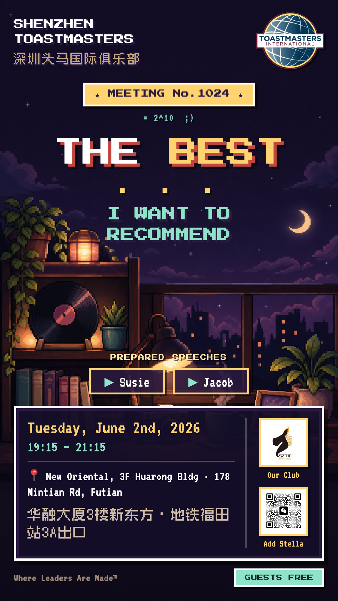
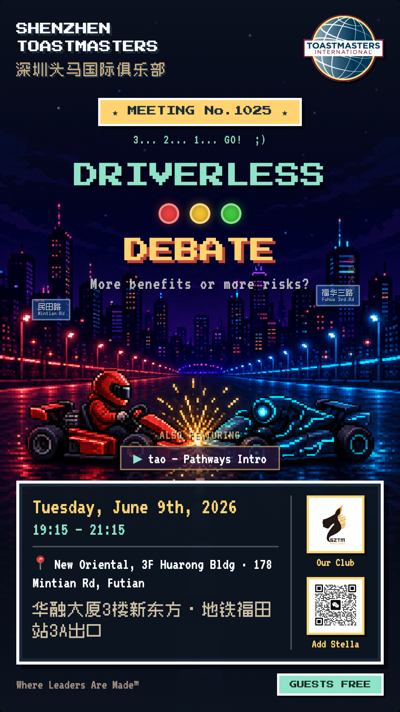
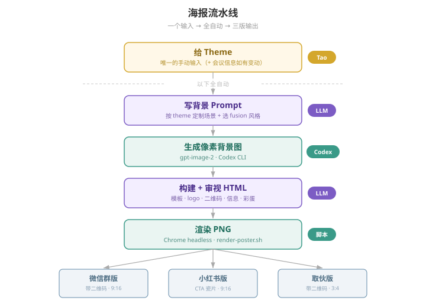

上半年我在深圳头马（SZTM）做 Treasurer，对着报表；下半年换岗做 VPPR，开始对着海报。

VPPR 每周有一项固定作业：周日之前出一张下周例会的海报，再发到微信群、小红书、取伙、公众号。会议每周开，海报就得每周做。

以前俱乐部基本都用 Canva。建好模板，每周打开换掉日期、演讲者和主题，再挪一挪元素、对齐、导出。能用，但每周重复这套动作，做几次就烦了。我是做 3GPP 标准研究的工程师，不会设计，鼠标拖来拖去既谈不上享受，也未必拖得好看。

所以我跟 Claude Code（下面简称 CC）许了个愿：能不能把画图、排版、导出这些体力活全交出去，每周只留需要我拍板的事，最好到最后我只需要给一个 theme？

## 架构：AI 画背景 + HTML/CSS 套模板

第一反应是直接让 Claude 写 HTML/CSS 出海报，毕竟写网页是它的强项。试了一下发现不行，纯代码排出来的东西太素，像一页 PPT。

于是改成两边分工：生图模型负责画氛围背景，CC 负责把会议信息、Logo 和二维码用 HTML/CSS 叠上去。

这里有个很明显的体会：画图也分类型。像科研示意图、流程图、架构框图这种本质上是结构加标记的图，让 Claude 直接写 SVG 最稳；但海报背景要的是画面感和氛围，这得交给图像生成模型。

用 HTML 模板代替 Canva 还有一个好处：所有位置都能用嘴改。不用拿鼠标去拽像素，直接跟 CC 说「标题再大两号」「Logo 加个浅色底」「信息框矮一点，别挡背景」，改完就能固定成规范，下周继续生效。

## 定一个风格，整个任期不换

背景试过梵高油画风、浪漫风，最后定在 8-bit 像素风（lo-fi cozy）。

选 8-bit 有个巧合：定下来的这期正好是 SZTM 第 1024 期。1024 是 $2^{10}$，1 KB 就是 1024 字节，而像素风恰好来自早年内存受限的年代。期数和画风对上了，我索性把它锁死成整个任期的视觉签名。

对我这种没有设计功底的人来说，锁死风格太省心了。不用每周从零纠结审美，底子固定是 8-bit，每期只在上面叠一点跟当期 theme 相关的风味（比如梵高星空、童年游戏或者《魔戒》），大家一眼认得出是 SZTM，每期看着又不重样。

## 让文字长在画面里

背景一复杂，文字就容易像硬贴上去的狗皮膏药。来回踩了几次坑，我给模板定了几条死规矩：

- **生成背景时预留干净区**，别让标题压在画面最乱的地方。
- **用 8-bit 的 RPG 对话框装会议信息**。像素游戏里的文本框本来就是画面的一部分，时间、地点、演讲者塞进去毫不违和。
- **黑色的 SZTM Logo 加浅色底托**，不然遇上夜景背景直接糊成一团。
- **信息框做成两列**：左列放时间地点，右列把 Logo 和二维码竖排，尽量把框压矮，少挡背景。
- **字宁大勿小**。海报多半在手机小屏上看，字小了等于没写。

英文标题用的是 [Press Start 2P](https://fonts.google.com/specimen/Press+Start+2P)，正文用 VT323。但一开始中文还是系统黑体，方块字和像素英文摆在一起瞬间出戏。后来让 CC 找来了开源的中文像素字体 **Zpix**，中英文才终于像同一个世界里的东西。

## 彩蛋：每期留个暗号

既然 1024 期开了头，我干脆给每张海报加了一个保留节目：在画面里藏一个跟期数或主题有关的小彩蛋。

1024 期是在会议徽章下面加了一行小字：`= 2^10 ;)`。

一开始我还想把梗解释清楚，写上「1024 = 2^10，1KB，8-bit 数字」，结果一解释完，那点会心一笑全没了。后来立了规矩：只给线索，绝不解释，结尾统一用 `;)` 当暗号。1025 是质数，1080 可以玩 Full HD，1111 既是二进制也是光棍节。要是老会员拿到海报先找彩蛋，这件零成本的小事反而成了这届 VPPR 最有辨识度的签名。

## 一张海报，三个平台版本

海报发出去要走不同渠道，各家规矩不一样：微信群版带 VPM Stella 的二维码，方便直接扫码；小红书严禁图片带二维码，发出去就限流，所以把二维码换成一块「私信报名 / DM to Join」的像素瓷片；取伙小程序则是 3:4 画幅。

模板建好之后，我还嫌手动打开浏览器截图太蠢，让 CC 写了个 `render-poster.sh`，调 Chrome 的 headless 模式直接把 HTML 渲染成对应尺寸的 PNG。

## 最后一块拼图：Codex CLI 直接生图

做到这一步，全流程只剩一个手动动作：把 CC 写好的背景 prompt 贴进 ChatGPT 网页端画图，再下载回来。

我隐约记得 OpenAI 的命令行工具 Codex CLI 是能直接画图的，就顺口问了一嘴。结果 CC 凭旧记忆非常笃定地告诉我：「Codex 不能生图。」

果断不信哈哈。让它去查官方文档，一查发现早就支持了：Codex CLI 内置了图像生成（模型是 `gpt-image-2`，通过 imagegen skill 触发），能直接从命令行调，而且走的是 ChatGPT 订阅额度，不用额外付 API 的钱。

（顺便留一条教训：千万别信 AI 对工具功能的记忆，它脑子里的版本常常是半年前的，一句「你去查一下文档」能省很多弯路。）

## 现在的流水线

连生图也接进来之后，整条链路彻底闭环了：

我现在每周花在海报上的时间，就是从当期 TTM 那里拿到 theme，打一行字发给 AI。以开头那张第 1024 期为例，我给的输入就一句 `The Best... I Want to Recommend`，剩下的写 prompt、调 Codex 画背景、套模板、埋彩蛋、导出三版 PNG，一气呵成。

我一直想把俱乐部里的工作流程沉淀成能带走的数字资产。现在这套 HTML 模板、字体、渲染脚本和彩蛋规范都在仓库里，下一任 VPPR 接手，或者 District 118 其他俱乐部想拿去改改换个风格，给个 theme 就能接着跑。

Happy Postering ;)
