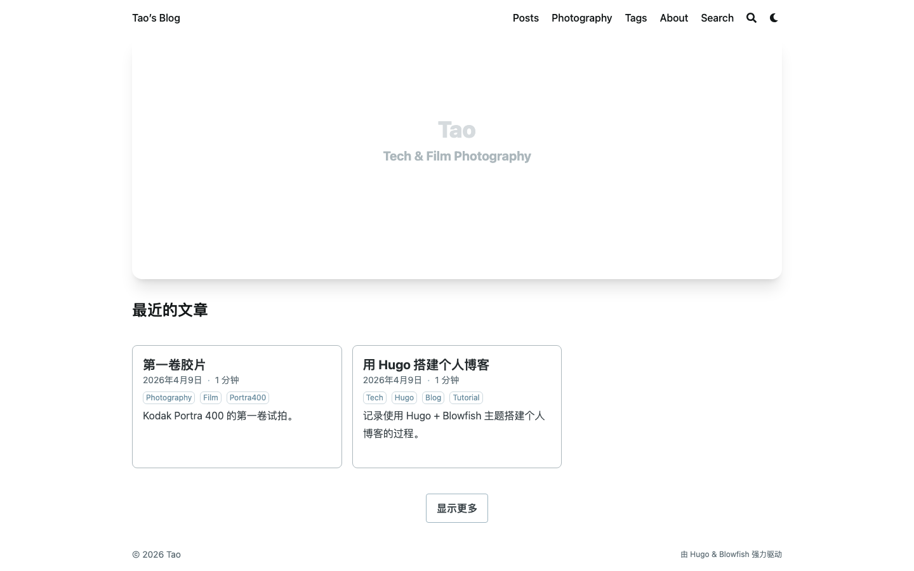
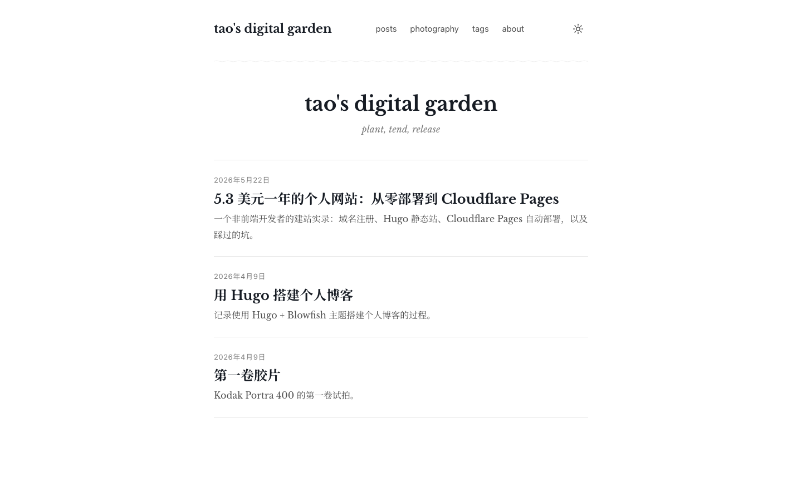
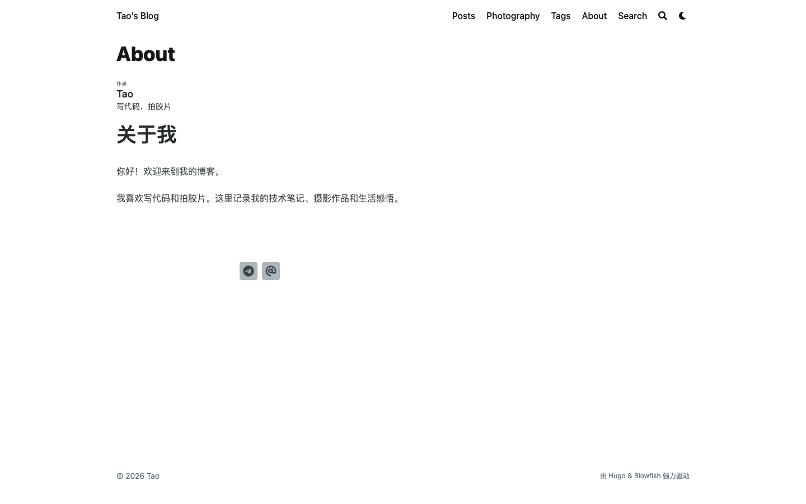
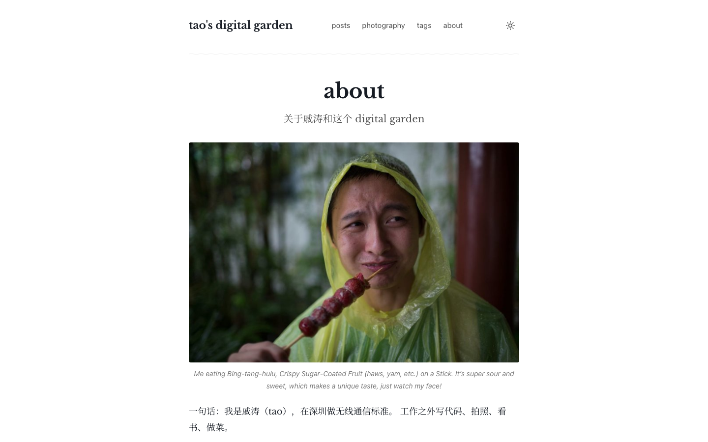
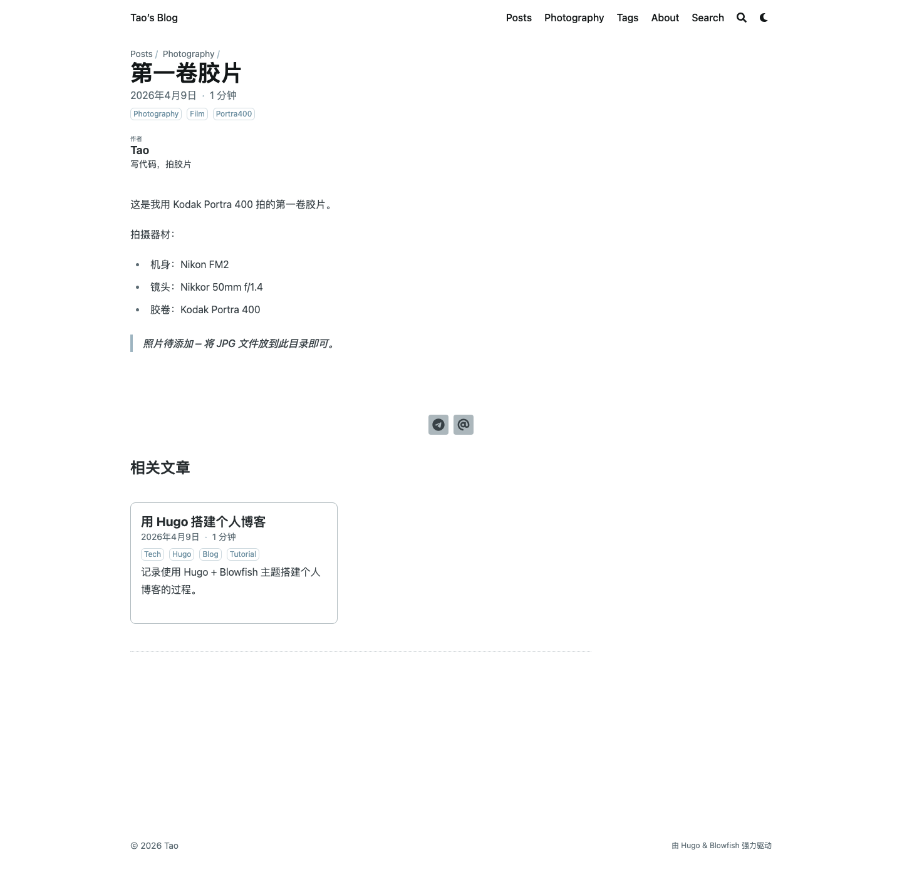
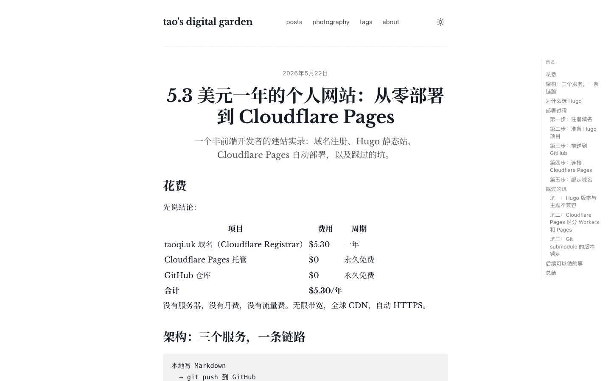

## 起点

这个博客之前跑在 Hugo + [Blowfish](https://blowfish.page) 上。Blowfish 是个很完整的主题，hero 区、卡片首页、breadcrumbs、相关文章、社交分享、TOC、暗色模式，一个博客该有的它全有。我当初选它也是因为这个，省事。

用了几个月，发现一件挺好笑的事：我打开自己博客的时候，眼睛在找卡片，不是在找文字。

首页一个大 hero 区，下面几张卡片，每张带着标签、阅读时长和摘要，摆得像个待挑的货架。可我自己打开博客是想顺着读读以前写过什么，不是来逛货架的。（当然也可能是我文章太少，总共三篇，挑不起来哈哈。）

## 转折点

刷到 [arslan.io](https://arslan.io/2025/11/18/my-two-part-desk-setup/) 的时候，一下就明白自己想要什么了。那个博客用的是 Ghost 的 [Kyoto 主题](https://themex.studio/kyoto/)：衬线字体（Libre Baskerville）、720px 居中单栏、几乎没有装饰，点开就是一篇能从头读到尾的文章。

看完我就想，我要这个。

## 不换主题，自己写

第一反应当然是去找一个像 Kyoto 的 Hugo 主题。但算了一下账：博客现在 3 篇文章，乐观估计一年 20 到 30 篇。这个规模，找主题、读文档、覆盖样式、再被它下一个 breaking change 拉回来修，其实比自己写一套 layout 更折腾。

那就自己写。做的全是减法：

- 删掉 `theme = "blowfish"`
- 在 `layouts/` 下写 6 个文件：`baseof.html`、`single.html`、`list.html`、`index.html`、`header.html`、`footer.html`
- 在 `assets/css/main.css` 写了大概 300 行 CSS，把 Kyoto 的样子搬过来
- 打包交给 Hugo 自带的资源管线（`resources.Get` / `Fingerprint` / `Minify`）。没有 Tailwind，没有 PostCSS，没有 Node

写完是这样：

hero 区没了，卡片框没了，标签徽章没了。剩下标题、副标题、一列按时间排的文章。蛮清爽的。

## 几个小决定

### 名字：tao's digital garden

之前叫 "Tao's Blog"，直接，也无聊。改成 `tao's digital garden`：

- 全小写，个人偏好
- "digital garden" 比 "blog" 更像我现在写东西的方式。博客是按时间线发出去就完事，花园是种下去之后还会回来修修剪剪，也不讲究顺序
- 副标题 `plant, tend, release`：种下、养护、放出去

副标题最早的版本是 `iteration — release & curate`，沿用我 2015 年那个 [qtwhat.com](https://qtwhat.com)。后来觉得 "iteration" 是工程师的词，放在花园里怪怪的，换成了三个动词。

### 关于页：糖葫芦

老博客（qtwhat.com，2015 到 2017）的关于页只有一张照片：我戴着黄色雨披咬糖葫芦，alt 文字是 *"It's super sour and sweet, which makes a unique taste, just watch my face!"*

我把这张 2016 年的照片翻出来，放回新的关于页，alt 一个字没改。中间停更了八年，名字、域名、主题全换了，糖葫芦还是那个糖葫芦。

### 文章页：右侧 TOC + 衬线正文

文章页变化最大：

- 正文用衬线，Libre Baskerville 配 Noto Serif SC，中英文放一起不打架
- 正文宽 720px，行高 1.8。长文读起来舒服的宽度，再宽眼睛就要来回跑了
- 右侧 sticky TOC，宽屏才显示，滚动时高亮当前段落（怎么做的[另写了一篇](/posts/static-site-scroll-spy/)）
- TOC 字小、灰、无衬线。它是导航，不是内容，不该抢正文的戏
- 章节之间的波浪线很细很淡（20px tile + 0.6px stroke + 0.10 opacity）。这是 Kyoto 的小签名，我喜欢，留着

### 暗色主题

跟随系统，右上角也能手动切。这个不该省。

## 写完之后

自己写主题比想象中容易得多。Hugo 自带的 `layouts/` 加 `assets/` 就够了，6 个 HTML 加 1 个 CSS，前端工程链一样没碰。我这种不写前端的人也能搞定。

划不划算看你写多少。一年写 200 篇，老老实实用现成主题。一年写 20 篇，但想十年后打开还是同一个站，那这 300 行 CSS 会越用越值。

还有个意外收获：把「发布」想成「放进花园」之后，草稿不完美也敢发了，反正还会回来修。这对我这种写一半就想全部推翻的人，蛮管用的。
